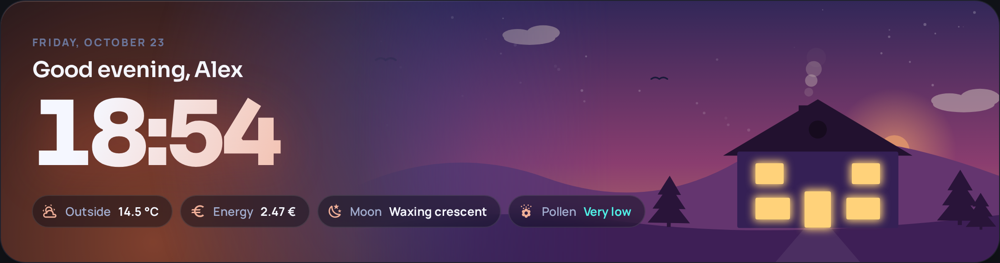
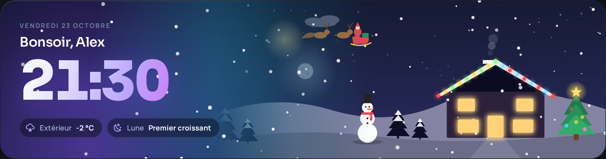
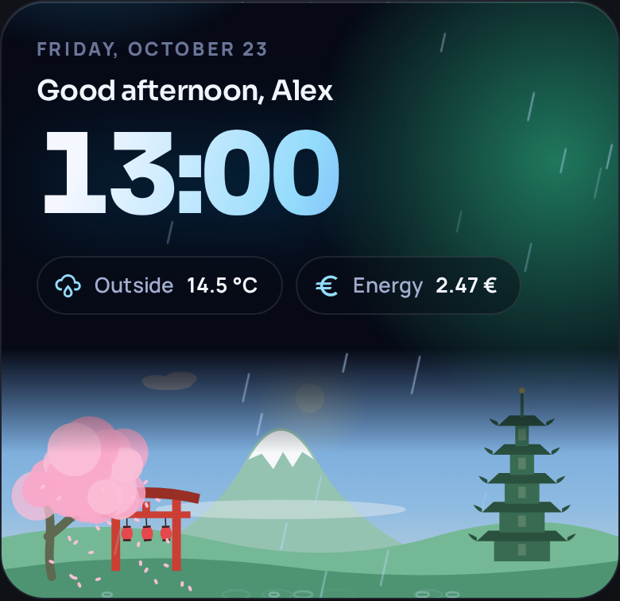

# Dynamic Home Card

🇬🇧 [Read in English](README.md)

Un bandeau d'accueil animé pour les tableaux de bord Home Assistant. Le ciel suit **le vrai soleil**, la scène suit **la vraie météo**, et tout le reste — salutation, date, heure, puces et action de chaque puce — se configure en YAML.



| Neige (français) | Pluie, carte étroite |
|---|---|
|  |  |

- 10 mondes animés (maison, ville, montagne, phare, forêt magique, espace, Japon, cyberpunk, Noël, océan)
- 11 effets (pluie, orage, neige, brouillard, feuilles, pétales, lucioles, étoiles filantes, feux d'artifice, bulles, confettis)
- **Météo automatique** : pluie quand il pleut, neige quand il neige, ciel gris et nuages épais par temps couvert — à partir de votre entité `weather.*`
- **Prévisions** (optionnel) : les prochains jours avec températures max/min, dans le même style verre
- **Lumière réelle** : les couleurs de l'aube et du crépuscule suivent le lever et le coucher de `sun.sun`
- Puces avec n'importe quelle entité, attribut, couleur, icône, template Jinja, conditions de visibilité, et les actions standard `tap_action` / `hold_action` / `double_tap_action`
- Français et anglais (d'autres langues bienvenues, voir [Traductions](#traductions))
- Un seul fichier JavaScript, aucune dépendance

> Le moteur de rendu et le design viennent d'[Aurora Glass v3](https://github.com/lucalux00/aurora-glass-v3) de DomotikPro.it (Luca Pinelli), sous GPL-3.0. Voir [NOTICE.md](NOTICE.md).

## Installation

### HACS (dépôt personnalisé)
1. HACS → ⋮ → **Dépôts personnalisés** → `https://github.com/gogui63/dynamic-home-card`, type **Tableau de bord**.
2. Cherchez **Dynamic Home Card** → **Télécharger**.
3. Rechargez le navigateur (Ctrl+Maj+R).

### Manuelle
1. Copiez `dist/dynamic-home-card.js` dans `config/www/dynamic-home-card/`.
2. Paramètres → Tableaux de bord → ⋮ → **Ressources** → ajoutez `/local/dynamic-home-card/dynamic-home-card.js` en **module JavaScript**.

## Exemple minimal

```yaml
type: custom:dynamic-home-card
weather_entity: weather.maison
```

## Exemple complet

```yaml
type: custom:dynamic-home-card
weather_entity: weather.openweathermap
world: house
language: fr
show_time: true
chips:
  - weather
  - entity: sensor.cout_elec_jour
    name: ÉLEC
    icon: mdi:currency-eur
    decimals: 2
    hold_action:
      action: navigate
      navigation_path: /energy
  - entity: sensor.lune_phases
    name: LUNE
    icon: mdi:weather-night
  - entity: sensor.qualite_globale_pollen_riom
    name: POLLEN
    icon: mdi:flower-pollen
    attribute: Libellé
    color_attribute: Couleur
tap_action:
  action: navigate
  navigation_path: /dashboard-maison/meteo
```

## Options

Toutes les options, puces et actions sont décrites dans le [README anglais](README.md#options) (les noms d'options sont identiques). Les plus courantes :

| Option | Défaut | Rôle |
|---|---|---|
| `weather_entity` | — | Entité `weather.*` : effets automatiques, ciel, puce météo. |
| `world` | `house` | Monde affiché. |
| `effect` | `auto` | `auto` (selon la météo), `none` ou un effet fixe. |
| `weather_effects` | — | Remplacer l'effet d'une condition, ex. `clear-night: shooting_stars`. |
| `show_time` | `true` | Afficher l'heure. |
| `show_date`, `show_greeting` | `true` | Afficher la date, la salutation. |
| `language` | `auto` | `auto` (profil HA), `fr`, `en`. |
| `fonts` | `google` | `theme` pour utiliser la police du thème HA (aucune requête externe). |
| `windows` | `auto` | Fenêtres éclairées : `auto` (la nuit), `on`, `off`, une entité ou une liste d'entités. |
| `chips` | `[weather]` | Liste des puces. |
| `show_forecast` | — | Interrupteur des prévisions dans l'éditeur visuel. `false` les masque même si `forecast` est défini. |
| `forecast` | `false` | `true` ou un objet pour afficher les prévisions, voir [Prévisions](#prévisions). |
| `preview_hour`, `preview_condition` | — | Figer l'heure ou la météo pour tester un rendu. |

## Prévisions

Désactivées par défaut. Dans l'éditeur visuel : activez **Afficher les prévisions**, les réglages sont dans la section **Prévisions**. En YAML : `show_forecast: true` ou `forecast: true` affiche les 5 prochains jours avec une icône, la température max et min, et une barre min/max. Ou détaillez :

```yaml
forecast:
  type: daily        # daily | hourly
  count: 5           # 1 à 12 entrées
  position: right    # right : à droite du bandeau quand il y a la place | below : sous les puces
  decimals: 0        # 0 à 2
  range_bar: true    # barre min/max de chaque jour, à l'échelle de la période affichée
```

Les prévisions viennent de `weather_entity` via l'abonnement aux prévisions de Home Assistant (mise à jour en direct, aucun capteur à créer). Sous 900 px de large, la position `right` affiche 3 jours ; sous 600 px, les prévisions passent toujours sous les puces. Un appui sur les prévisions déclenche le `tap_action` de la carte.

## Traductions

Les textes sont dans [`src/i18n.js`](src/i18n.js). Copiez le bloc `en`, traduisez-le, proposez une pull request.

## Licence

GPL-3.0-or-later. Contient du code issu d'Aurora Glass v3 © 2026 DomotikPro.it (Luca Pinelli), GPL-3.0 — voir [NOTICE.md](NOTICE.md).
